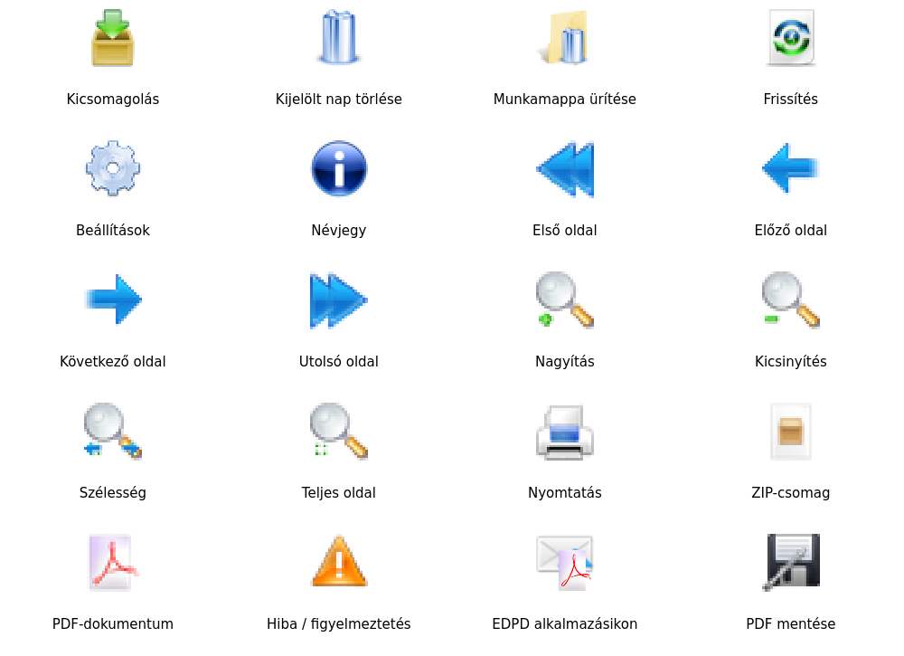

# EDPD – Postai dokumentumkezelő

Magyar nyelvű, helyben futó Windows-alkalmazás a Magyar Posta napi EDPD ZIP-csomagjainak kezeléséhez, a munkamappa PDF-jeinek megtekintéséhez és nyomtatásához. Nincs dokumentumfeltöltés, telemetria vagy külön szerver.

## Windows letöltés

**[EDPD 2.2.0 – Windows-verzió letöltése](https://github.com/baloghim/beerkezett_posta_kezeles/releases/download/v2.2.0/EDPD-Manager-Windows-x64.zip)**

A fejlesztői változat **2.3.0**. A Windows-build és az új kiadás ellenőrzése folyamatban van; a fenti link egyelőre a korábbi, ellenőrzött 2.2.0 verziót tölti le.

## Újdonságok a 2.3 változatban

- 40 pixeles fő eszköztár, kisebb PDF-eszköztár. Félkövér, kissé nagyobb panelcímek, kényelmesebb táblázatsorok. A gyári Qt-stílusok megmaradtak, nincs dekoratív QSS.
- Arányos, kézzel átméretezhető oszlopok. Fent: 18/44/10/28%. Lent: **Nap – Fájlnév – Méret**, 21/64/15%. A Nap az eredeti ZIP dátuma (`ÉÉÉÉ.HH.NN.`); a sorrend dátum szerint csökkenő, azon belül fájlnév szerint növekvő. Ismeretlen és többértelmű eredet a dátumos tételek után marad. A munkamappa továbbra is kizárólag a célmappa közvetlen PDF-jeiből áll; a felső kijelölés nem szűri.
- A További forráskeresés gomb csak további ZIP-ek esetén látszik, a keresés végén eltűnik.
- A kicsomagolás külön **modális folyamatablakban** fut, Crystal ikonnal, dátummal, valós fájlszámmal és Mégse gombbal. A Qt eseményciklusa működik, a főablakot a művelet fogja.
- Először az összes szükséges PDF ellenőrzött ideiglenes területre kerül, biztonsági másolatokkal; utána ellenőrzött véglegesítés következik. Megszakítás és hiba esetén a saját új fájlokat visszavonjuk, a felülírtak eredeti tartalmát helyreállítjuk. A hálózati zár a teljes művelet alatt megmarad. Részleges helyreállításnál a program név szerint jelzi a problémákat és megőrzi a naplót/másolatokat. [Helyreállítás és korlátai](docs/RECOVERY.md).
- A PDF-eszköztár Szélesség, Teljes oldal és Nyomtatás gombjai ikont és feliratot is mutatnak. Az új **PDF mentése** az eredeti, teljes PDF bájtjait menti, nem a renderelt képet; ZIP-betekintésből is működik. A Mentés másként az eredeti nevet ajánlja, megerősítteti a felülírást, és atomikus `QSaveFile` írást használ. A forrásarchívumba és a munkamappába nem exportálhat, így ezek állapotát nem módosítja.
- A napi lista célzott jobb gombos menüje **Feldolgozva / Feldolgozás visszavonása** helyi jelölést ad. Tárolás: `%LOCALAPPDATA%\EDPD\local-state\processed.json`; nincs közös hálózati állapotmappa. Az azonosító a forrásmappát és a napi csomagot is tartalmazza. A teljes zöld sor elsőbbséget élvez a félkövér jelzéssel szemben, az állapotoszlop a tényleges kicsomagoltságot is mutatja. A jelölés nem végez PDF-műveletet, és új verzió telepítésekor is megmarad. A Betekintő képességkészlet nem engedi ezt a funkciót.


A teljes ZIP-et új helyi mappába bontsa ki, az `_internal` mappát is tartsa meg. Python telepítése nem szükséges. A Windows buildet a meglévő [GitHub Actions workflow](https://github.com/baloghim/beerkezett_posta_kezeles/actions/workflows/windows-build.yml) készíti.

## Megőrzött alapműködés

- A Kicsomagolás gomb és a napi lista dupla kattintása ugyanazt a műveletet indítja. Egy kattintás csak kijelöl.
- Ha a kijelölt napból nincs PDF a célban, a kicsomagolás kérdés nélkül indul.
- Ha minden PDF jelen van, rövid tájékoztatást kap; nincs új kicsomagolás vagy felülírási ajánlat.
- Részleges adagnál megjelenik a meglévő és hiányzó fájlok száma. Választható a hiányzók kicsomagolása (alapérték), a meglévők felülírása vagy a Mégse.
- A folyamatjelző előkészítéskor/ellenőrzéskor határozatlan, PDF-feldolgozáskor a tényleges darabszámot mutatja. A művelet háttérszálon fut; a főablakot a modális ablak fogja. A sikeres kicsomagolás eredménye a státuszsorban jelenik meg.
- Közös hálózati jelölési rendszer továbbra sincs. A régi `shared_data` kulcsot betöltéskor figyelmen kívül hagyjuk, új mentésbe nem kerül. A korábbi hálózati mappát és fájljait nem töröljük és nem nyitjuk meg.
- Valódi Crystal Remix ikonok: 40 pixeles fő eszköztár, kisebb 22 pixeles PDF-eszköztár, ZIP/PDF-listaikonok és hétméretes EDPD ICO. [Ikonforrások, licencek és módosítások](docs/ICONS.md).
- A Qt-stílusválasztó megmarad, a `WindowsVista` megjelenített neve **Vista**, a tárolt tényleges stílusnév változatlan. A választékot a `QStyleFactory.keys()` adja. Sikeres mentés után azonnali váltás; Mégse esetén nincs módosítás. Hiányzó stílusnál Fusion az alapérték. Nincs globális dekoratív QSS.



## Mappák és munkafolyamat

| Beállítás | Alapérték |
| --- | --- |
| Forrásarchívum – kizárólag olvasás | `H:\PostaEDPB\10_Komárom-Esztergom megye` |
| Ideiglenes munkamappa | `G:\Igazgatas\DMS_One\00_t_meghajtóról érkezők` |
| Napi ZIP-lista időszaka | 14 nap |
| Automatikus frissítés | 15 perc |

Az útvonalak a Beállításokban módosíthatók és tallózhatók. Meghajtóbetűjel és UNC-megosztás is használható. A forrás és cél legyen különálló, egyik sem lehet a másik szülőmappája. A program nem hozza létre automatikusan ezeket. A forrásban soha nem végez próbaírást.

A bal felső **EDPD mappa tartalma** panel napi ZIP-eket és automatikus fájlállapotot mutat: Nincs kicsomagolva, Kicsomagolva (félkövér fekete), Részben kicsomagolva, Hibás csomag / Fájlütközés. A bal alsó **A munkamappa dokumentumai** panel kizárólag a célmappa közvetlen PDF-jeit mutatja. A felső kijelölés nem szűri a munkamappát és nem cseréli le az olvasott PDF-et. A három panel továbbra is méretezhető.

A ZIP-listában a 14/30/90/180 nap és Összes választható. A dátumszűrés ZIP-megnyitás előtt történik. Induláskor és automatikus/kézi frissítéskor nincs történeti háttérkeresés. A Forrásnap régebbi megfeleltetése külön a **További forráskeresés** gombbal kérhető, szüneteltethető. Ismeretlen eredetű PDF is olvasható és nyomtatható. Több találatnál „Több lehetséges nap” jelenik meg.

A jobb oldali PDF-betekintő minden új dokumentumot **Szélesség** nézetben nyit. A **Teljes oldal** külön választható. Lapozás, nagyítás, nyomtatási párbeszéd és a teljes PDF-oldalak nyomtatása megmaradt. ZIP-ből kicsomagolás nélküli betekintés a felső lista jobb kattintásos menüjével érhető el.

A **Kijelölt nap fájljainak törlése** kizárólag a kijelölt csomag ténylegesen jelen lévő PDF-jeire vonatkozik, megerősítés után. A **Munkamappa ürítése** minden közvetlen PDF-et törölhet, megerősítés után; más fájltípust, almappát és technikai állományt nem töröl. A forrásarchívum változatlan marad.

A helyi konfiguráció `%APPDATA%\EDPD\settings.json`, az index `%LOCALAPPDATA%\EDPD\zip-index` alatt található. Linuxon a felhasználói konfiguráció alá kerülnek.

## Többfelhasználós biztonság és teljesítmény

A `.edpd-operation.lock` operációsrendszer-szintű zár megmaradt kicsomagoláshoz és törléshez. A zárfájlt nem szabad törölni. A célállapotot a zár megszerzése után ismét ellenőrizzük; felülírás csak a jóváhagyott fájllistára és ellenőrzött fájlállapotra vonatkozhat. Változás esetén új megerősítés szükséges. Új fájl véletlen felülírását az atomikus létrehozás is megakadályozza.

A kicsomagolás előkészítése csak a kijelölt napi ZIP-et és a célmappát vizsgálja. Teljesen jelen lévő adagnál nincs teljes történeti ZIP-ellenőrzés. Tényleges írás és célzott törlés előtt azonban az összes nap névütközéseit ellenőrizni kell: hideg indexnél ehhez történeti tartalomjegyzék-olvasás is szükséges. Ezt nem távolítottuk el, mert különben a régebbi csomagokkal való ütközés nem zárható ki. Változatlan történeti ZIP-nél a mérettel/időbélyeggel ellenőrzött helyi index használható. PDF-tartalmat ekkor sem olvasunk. Ez háttérben, látható határozatlan folyamatjelzéssel fut.

A státusz fájlnév és méret alapján készül, nem tartalmi hitelességvizsgálat. Külső alkalmazások nem feltétlenül tartják tiszteletben a fájlzárat; művelet közben ne módosítsák a célmappát más programmal. Részletes átvételi próba: [Windows / SMB / nyomtatás](docs/WINDOWS-VALIDATION.md).

## Fejlesztés és ellenőrzés

Változatlan alap: Python **3.10**, PySide2 **5.15.2.1 / Qt 5.15.2**, PyMuPDF **1.23.26**. Windows buildhez Python **3.10.11 x64**. Nem történt Qt 6-ra váltás, nincs új futásidejű függőség.

```powershell
py -3.10 -m venv .venv
.venv\Scripts\python -m pip install -e ".[dev]"
.venv\Scripts\python -m edpd.main
$env:QT_QPA_PLATFORM = "offscreen"
.venv\Scripts\python -m pytest -q
.venv\Scripts\python -m PyInstaller --noconfirm --clean EDPD-Manager.spec
```

Linuxon: `QT_QPA_PLATFORM=offscreen .venv-qt5/bin/python -m pytest -q`. A meglévő izolált checkout használható; új Git worktree nem szükséges. A tesztek kizárólag szintetikus adatokat és ideiglenes mappákat használnak, éles NEAK-megosztáson nem végeznek műveleteket. Lefedik az 1000 ZIP-es szűrést, az önálló munkamappa-listát, a versenyhelyzeteket, a folyamatjelzést és a PDF-nyomtatást.

A csomagolt EXE önellenőrzése:

```bat
EDPD-Manager.exe --self-test --require-windows1607 --report "%USERPROFILE%\Desktop\EDPD-2.3.0-1607.json"
```

A Windows workflow natív DLL-auditot, EXE-ikonerőforrás-vizsgálatot, a csomagolt ikonfájlok összehasonlítását és az EXE tizenhárom funkcionális önellenőrzését is végzi. A `v*` címkéhez sikeres build után Release-t készít. [Windows 1607 útmutató](docs/WINDOWS1607.md). A modern runner sikere nem helyettesíti a valódi 1607-es célgépes próbát; a korábban ott ellenőrzött 0.2.1 kiadás sikere az új változatot nem minősíti.

## Licencek

A projekt saját kódjára a jogtulajdonos még nem választott terjesztési licencet. A PySide2/Qt, PyMuPDF és PyInstaller feltételeit a [LICENSE](LICENSE) foglalja össze.

Crystal Remix: eredeti Crystal Project / Crystal Clear ikonok **Everaldo Coelho**, modern átdolgozás **Viet Dang (Đặng Việt Dũng)**, **GNU LGPL** (az upstream nem nevez meg verziót). Az eredeti README és licencszövegek a [licenses/crystal-remix](licenses/crystal-remix) alatt vannak. A színezett és kombinált EDPD-változatok forrásait és az újragenerálást a [docs/ICONS.md](docs/ICONS.md) dokumentálja. A tároló PNG-állományokat tartalmaz, nem állítjuk, hogy ezek eredeti SVG-források.
