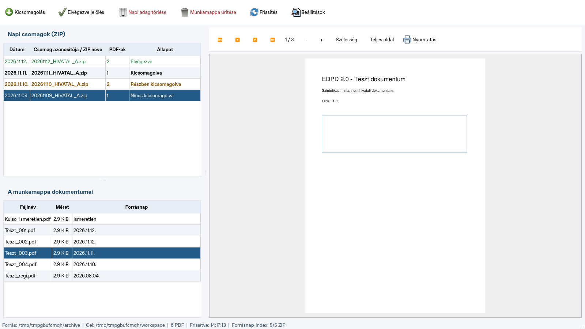

# EDPD – Postai dokumentumkezelő

Magyar nyelvű, helyben futó Windows-alkalmazás a Magyar Posta napi EDPD ZIP-csomagjainak kezeléséhez, a munkamappa PDF-jeinek megtekintéséhez és nyomtatásához. Nincs dokumentumfeltöltés, telemetria vagy külön szerver.

## Windows letöltés

Elkészült a **2.0.1 hibajavító kiadás**: megszünteti az automatikus történeti ZIP-keresést, és külön ellenőrzi a munkamappa-lista függetlenségét, valamint a Forrásnap oszlopot.

**[EDPD 2.0.1 – Windows-verzió letöltése](https://github.com/baloghim/beerkezett_posta_kezeles/releases/download/v2.0.1/EDPD-Manager-Windows-x64.zip)**

A 2.0.1 Windows buildje, **78 automatikus tesztje**, a becsomagolt EXE **tíz funkcionális önellenőrzése** és 107 natív bináris DLL-auditja sikeres. Az 1000 ZIP-es grafikus mérés 14 napnál 14 megnyitást, 14 napi sort és nulla időszakon kívüli megnyitást igazolt, automatikus frissítés után is. A közzétett ZIP-et letöltöttük: CRC-ellenőrzése hibátlan, SHA-256 ellenőrző összege egyezik, a teljes szükséges runtime-készlet jelen van.

A technológiai alap változatlan: Python **3.10.11 x64**, PySide2 **5.15.2.1 / Qt 5.15.2**, PyMuPDF **1.23.26**. A teljes ZIP-et **új helyi mappába** bontsa ki, majd indítsa az `EDPD-Manager.exe` fájlt. Az `_internal` mappát is meg kell tartani. Python vagy Visual C++ fejlesztőeszköz telepítése nem szükséges; a runtime DLL-ek a csomagban vannak.

A 0.2.1 csomagolt EXE a céges Windows 10 **1607 x64, build 14393** gépen sikeres önellenőrzést teljesített. Az új **2.0.1** kiadás külön célgépes próbája még szükséges. A modern runner sikere ezt nem helyettesíti. [Windows 1607 útmutató](docs/WINDOWS1607.md) · [Ellenőrzési eredmények](docs/VALIDATION.md).

A [Windows build](https://github.com/baloghim/beerkezett_posta_kezeles/actions/workflows/windows-build.yml) sikeres futásának **Artifacts** részében a csomag és SHA-256 ellenőrző összege is elérhető. A `v*` verziócímkével indított sikeres futás GitHub Release-t készít.

## A 2.0 fő funkciói

- Három méretezhető panel: **napi csomagok**, **a teljes munkamappa dokumentumai**, **PDF-betekintő**.
- Induláskor az **elmúlt 14 naptári nap**, a mai nappal együtt. Választható: 14/30/90/180 nap vagy Összes.
- A ZIP-ek dátumszűrése a tartalomjegyzék megnyitása előtt történik; listázáskor PDF-adatot nem olvasunk.
- Tartós, helyi ZIP-metaadat-index a változatlan régi ZIP-ek felesleges újranyitásának elkerülésére.
- Közös **Elvégezve jelölés / Jelölés visszavonása**, a PDF-ek állapotától függetlenül.
- A napi listában az elvégzett nap zöld, a kicsomagolt nap félkövér fekete, a részben jelen lévő nap külön színt kap. A kijelölt sor kontrasztos marad.
- A munkamappa-lista minden közvetlen PDF-et mutat: fájlnév, méret, forrásnap. A felső lista kiválasztása nem szűri ezt és nem váltja át az olvasott PDF-et.
- Lapozás, nagyítás, szélességhez/teljes oldalhoz igazítás, natív Windows nyomtatási párbeszéd és teljes PDF-oldalak nyomtatása.
- Teljes napi kicsomagolás, meglévők kihagyása vagy külön választott felülírás; megerősített napi törlés és munkamappa-ürítés.
- Kézi frissítés és 5–60 perces automatikus ellenőrzés, 15 perces alapértékkel. A hálózati műveletek háttérben futnak.



## Beállítások és mappák

Célplatform: Windows 10 1607 x64, ajánlott Full HD kijelző. A forráshoz olvasási, a munkamappához és közös jelölésekhez megfelelő írási/törlési és hálózati zárolási jogosultság szükséges.

| Beállítás | Alapérték |
| --- | --- |
| Forrásarchívum – kizárólag olvasás | `H:\PostaEDPB\10_Komárom-Esztergom megye` |
| Ideiglenes munkamappa | `G:\Igazgatas\DMS_One\00_t_meghajtóról érkezők` |
| Közös jelölések mappája | `G:\Igazgatas\DMS_One\EDPD_appdata` |
| Napi ZIP-lista időszaka | 14 nap |
| Automatikus frissítés | 15 perc |

A **Beállítások** panelen minden útvonal módosítható és tallózható. Meghajtóbetűjel és UNC, például `\\szerver\megosztas\mappa` is használható. A program normalizálja az ismételt elválasztójeleket, és megőrzi az UNC kezdő dupla fordított perjelét. A forrást és munkamappát nem hozza létre automatikusan. A közös jelölések mappája mentéskor, illetve az első jelöléskor létrehozható, ha a szülőmappa elérhető és írható.

Mindhárom mappa legyen különálló; nem lehetnek egymás részei vagy szülőmappái. A forrásban nem készül próbaírás, technikai fájl vagy napló. Nem elérhető útvonalnál a program érthető hibát jelez és a Beállításokból javítható. Ha csak a forrásarchívum nem érhető el, a hozzáférhető munkamappa PDF-jei továbbra is olvashatók, a módosító műveletek viszont letiltódnak.

A személyes konfiguráció helye `%APPDATA%\EDPD\settings.json`, az ablak- és panelméretekkel, útvonalakkal, időszakkal és frissítési idővel együtt. A régebbi konfigurációhoz az új mezők alapértékei automatikusan hozzáadódnak.

## Gyors ZIP-lista és a dokumentumok forrásnapja

A könyvtár fájlneveit és metaadatait beolvassuk, a `YYYYMMDD` dátum alapján kiválasztjuk a napokat, majd csak ezek ZIP-tartalomjegyzékét nyitjuk meg. A sorrend dátum szerint csökkenő. Egy nap több ZIP-je együtt jelenik meg. Az Összes nézet hideg indexnél hosszabb ideig tarthat, a felület közben használható.

A helyi index helye `%LOCALAPPDATA%\EDPD\zip-index` (Linuxon a felhasználói konfiguráció alatt). Csak fájlnevek, méretek, CRC-k és ZIP-időbélyegek szerepelnek benne, PDF-tartalom nem. A ZIP méretét és módosítási idejét minden ellenőrzéskor összevetjük az indexszel; a helyi rekordok ellenőrző összegét is vizsgáljuk. A sérült helyi index újraépíthető, nem üzleti állapot.

A munkamappában régi, a felső időablakból már kiesett PDF is lehet. Először a kiválasztott időszak és a korábbi, még érvényes helyi index megfeleltetéseit használjuk. **Induláskor és automatikus/kézi frissítéskor nincs történeti háttérkeresés**, nem üres munkamappánál sem. Az ismeretlen eredet nem akadályozza a PDF megnyitását vagy nyomtatását.

A munkamappa-panel **További forráskeresés** gombjával külön kérhető a még hiányzó régebbi ZIP-tartalomjegyzékek beolvasása. Ez háttérben, kis adagokban fut és szüneteltethető; a pillanatnyilag futó adag még befejeződhet. A keresés engedélye nem marad meg újraindítás után. Az Összes időszak választása természetesen a teljes napi listát tölti be.

- Nem azonosítható fájl: **Ismeretlen**.
- Több ismert napi ZIP-ben szereplő fájlnév: **Több lehetséges nap**.
- A dátum az ismert, friss tartalomjegyzékekből származik. A még nem vizsgált régi ZIP-ek további egyezést is tartalmazhatnak; a lefedettség az állapotsorban látható, bővítése csak külön kéréssel történik.

Az aktív időszak, a pontos programverzió és a külön indított keresés állapota az állapotsorban látható. Az időszakon kívüli eredetkeresés nem bővíti ki a felső napi listát.

## Elvégezve jelölés

A felső listában válasszon napot, majd használja az **Elvégezve jelölés** gombot. A gomb ezután **Jelölés visszavonása** feliratot kap. A jelölés sem kicsomagolást, sem törlést nem végez.

A közös mappában a `completed.json` kizárólag az elvégzett napi csomagok azonosítóit és igaz jelöléseit tárolja. Az azonosító a dátumot, az aznapi ZIP-ek neveit és PDF-metaadatait egyesíti, nem a helyi meghajtóbetűjelet. Más hivatal csomagjai elkülönülnek; hozzáadott ZIP vagy megváltozott PDF-tartalom új csomagazonosítót eredményez. Felhasználónév, PDF-tartalom és teljes feldolgozási történet nem kerül a fájlba.

Módosításkor a `.edpd-marks.lock` közös OS-fájlzár alatt újraolvassuk a teljes aktuális állapotot, összeolvasztjuk az adott jelölést, majd ideiglenes fájl és atomikus csere segítségével mentünk. Két külön napi jelölés nem írja felül egymást. Foglaltság vagy hálózati hiba érthető üzenetet ad. Sérült közös állományt nem írunk felül üres állapottal: a felület külön figyelmeztet és letiltja a jelölés módosítását.

Másik gép változtatása a következő kézi vagy automatikus frissítéskor látható. A kicsomagolás, napi törlés és ürítés a jelöléseket nem módosítja. A zöld Elvégezve állapot elsőbbséget élvez a munkamappából számított kicsomagoltsággal szemben.

## Napi munkafolyamat

1. Válasszon napot a felső listában. A napi műveletek erre a napra vonatkoznak.
2. A **Kicsomagolás** a nap összes ZIP-jének PDF-jeit közvetlenül a munkamappába teszi. Válasszon kihagyást, felülírást vagy Mégse lehetőséget. CSV és belső ZIP-almappa nem kerül a célba.
3. Az alsó listában kattintson PDF-re: a program a munkamappából olvassa be. A jobb oldali **Nyomtatás** az éppen megnyitott teljes PDF-hez nyit párbeszédet.
4. ZIP-ből, kicsomagolás nélkül is lehet betekinteni: jobb kattintás a felső napi sorra, **ZIP-csomag PDF-jeinek megtekintése…**, majd dokumentum és **Megtekintés kicsomagolás nélkül**. A napra történő kattintás vagy duplakattintás önmagában nem nyit ZIP-dokumentumlistát. Az alsó panel továbbra is a munkamappa marad.
5. A **Napi adag törlése** a felső kiválasztás teljes ZIP-listáját veti össze az aktuális munkamappával. Például hat csomagbeli PDF-ből négy jelen lévőnél a párbeszéd kifejezetten négy törlendő PDF-et jelez. Más napok fájljai megmaradnak.
6. A **Munkamappa ürítése** minden közvetlen PDF-re vonatkozik, megerősítés után. Almappát, ZIP-et, CSV-t, technikai fájlt és közös jelölést nem töröl.
7. Az ügyintézés befejezését külön az **Elvégezve jelölés** rögzíti. A dokumentumok ettől a munkamappában maradhatnak.

## Többfelhasználós fájlműveletek

A kicsomagolás és törlés a cél `.edpd-operation.lock` fájlján közös operációsrendszer-szintű zárat használ. A zárfájlokat nem szabad törölni. Folyamatkilépéskor az OS oldja a zárat; hálózati kiesés utáni feloldás ideje az SMB-kiszolgálótól is függ.

A módosító művelet a zár alatt újraolvassa a kijelölt nap tartalomjegyzékét és újraellenőrzi a célfájlokat. Az ütközésvizsgálat a megjelenített időszakon kívüli napokra is kiterjed, a friss ZIP-metaadatokkal ellenőrzött gyorsítótár használatával. Hideg indexnél ez hosszabb ellenőrzést jelenthet, háttérben. Azonos fájlnév több napi csomagban: a napi törlés leáll, a bizonytalan fájl megmarad. A megerősítés óta megváltozott törlendő fájllistához új megerősítés kell.

A kicsomagolás ellenőrzött ZIP-olvasásból ideiglenes fájlba, majd atomikus átnevezéssel/cserével történik. Egy napi művelet fájlonként atomikus: megszakadáskor a már elkészült dokumentumok megmaradnak. Frissítés után a hiányzók kihagyásos kicsomagolása újraindítható.

A működési korlátokat és a fizikai Windows/SMB/nyomtatási próbát a [Windows-átvételi útmutató](docs/WINDOWS-VALIDATION.md) tartalmazza. A jövőbeni Viewerhez a `Capabilities.viewer()` a programlogikai rétegben is tiltja a törlést, felülírást és kézi jelölést; ebben a kiadásban csak a Manager készül.

## Fejlesztői telepítés és tesztek

Python **3.10** szükséges; PySide2 nem támogatja a 3.11+ verziókat. Windows PowerShell:

```powershell
py -3.10 -m venv .venv
.venv\Scripts\python -m pip install -e ".[dev]"
.venv\Scripts\python -m edpd.main
$env:QT_QPA_PLATFORM = "offscreen"
.venv\Scripts\python -m pytest -q
```

Linuxon a megfelelő környezet `.venv-qt5/bin/python`; például `QT_QPA_PLATFORM=offscreen .venv-qt5/bin/python -m pytest -q`. A meglévő izolált checkout használható, új Git worktree nem szükséges.

A tesztek kizárólag szintetikus ZIP/PDF adatokkal, ideiglenes forrás-, cél-, közös állapot- és felhasználói mappákkal dolgoznak. Éles NEAK megosztáson nem végeznek műveletet. Az 1000, több évre elosztott ZIP-et használó grafikus teszt minden időszaknál rögzíti a forrásállományok számát, az időszak találatait, a tényleges ZIP-megnyitásokat és a Qt-táblázat sorait. A mérések a CI JUnit-eredményében is szerepelnek. A tesztcsomag lefedi a dátumszűrést, a megnyitás előtti kizárást, az indexet és eredetet, a kézi jelölések többfolyamatos mentését, a célzott törlést, a színezést és munkamappa-listát, valamint a PDF-et és a nyomtatási előkészítést.

Önálló ellenőrzés, kizárólag ideiglenes adatokkal:

```bat
EDPD-Manager.exe --self-test --require-windows1607 --report "%USERPROFILE%\Desktop\EDPD-2.0-1607.json"
```

A jelentés alkalmazásverziót, OS-buildet, a tényleges felület oszlopait és címét, a szűrt indulás adatait és tíz ellenőrzés eredményét tartalmazza. A `windows1607_verified` kizárólag valódi 14393-as Windows 10 x64 munkaállomáson lehet igaz.

## Windows EXE készítése

Windows alatt Python 3.10.11 x64 és a fejlesztői függőségek telepítése után:

```powershell
.venv\Scripts\python -m PyInstaller --noconfirm --clean EDPD-Manager.spec
```

A spec a Qt és MuPDF komponenseket, a Python saját C-runtime-ját és a teljes rögzített VC-készletet csomagolja. A workflow teszteket, tényleges csomagolt EXE-indítást, statikus DLL-auditot, ZIP-et és SHA-256 fájlt készít. Verziózott kiadáshoz például `v2.0.1` címke használható. A verziószámot a `pyproject.toml` és `src/edpd/__init__.py` fájlokban együtt kell módosítani.

## Verzió és licencek

Fejlesztői verzió: **2.0.1**. A 0.2.1 natív alapja Windows 1607-en kipróbált, az új kiadás célgépes és munkahelyi átvételi próbája még szükséges.

A projekt saját kódjára a jogtulajdonos még nem választott terjesztési licencet. A PySide2/Qt és PyMuPDF külön licencei érvényesek; részletek a [LICENSE](LICENSE) fájlban.
