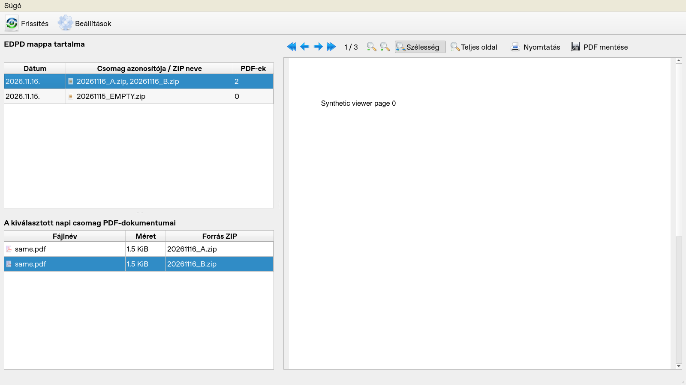

# EDPD Betekintő 2.6.3

[Windows x64 letöltés](https://github.com/baloghim/beerkezett_posta_kezeles/releases/download/v2.6.3/EDPD-Betekinto-Windows-x64.zip)

Az önálló `EDPD-Betekinto.exe` a napi EDPD ZIP-csomagok olvasására szolgál. A teljes ZIP-et új helyi mappába bontsa ki, az `_internal` könyvtárral együtt. Nem szükséges Python vagy a Menedzser telepítése. A Menedzserrel egyszerre futtatható, saját egypéldányos védelemmel.



## Használat

1. A Beállításokban válassza ki a csak olvasott Forrásarchívum mappát. Helyi könyvtár, Windows-meghajtó és UNC-útvonal is használható. Munkamappát nem kell megadni. A program nem hozza létre a forrásmappát, és nem végez benne próbaírást.
2. Felül az **EDPD mappa tartalma** napok szerint csoportosítja a ZIP-eket, a legfrissebb nappal kezdve. Induláskor a legfrissebb nap kijelölt. A három oszlop: Dátum, Csomag azonosítója / ZIP neve, PDF-ek.
3. Alul **A kiválasztott napi csomag PDF-dokumentumai** jelennek meg fájlnév, majd forrás-ZIP szerint rendezve. Azonos nevű dokumentumok külön sorban maradnak, teljes archívum- és bejegyzésazonosítóval. Nincs Állapot oszlop, ZIP-listás helyi menü vagy kicsomagoló dupla kattintás.
4. Egy PDF kijelölése háttérben, közvetlenül a ZIP-ből olvassa annak bájtjait, és memóriából megnyitja. Nem készül ideiglenes PDF-fájl. A ZIP-bejegyzések biztonsági ellenőrzései, méretkorlátai és CRC-ellenőrzései érvényben maradnak.
5. A jobb oldalon használható az első/előző/következő/utolsó oldal, nagyítás, kicsinyítés, Szélesség és Teljes oldal. A **Nyomtatás** a teljes PDF-oldalakat nyomtatja. A **PDF mentése** az eredeti bájtokat menti az egyedileg választott célfájlba; a forrásarchívumba nem exportálhat. Létező fájl felülírásához megerősítés szükséges.

Másik nap kijelölése törli az előző dokumentumot. Gyors dokumentumváltáskor csak a legújabb kijelölés eredménye jelenhet meg. Frissítéskor megmarad a létező kijelölt nap, illetve a változatlan PDF lapja és nagyítása. Megváltozott dokumentum újratöltődik, eltűnt dokumentum törlődik a betekintőből. Új nap nem veszi el a kijelölést. Olvasási hiba a felületen jelenik meg; a Frissítés gombbal újra próbálható.

A fő eszköztár kizárólag **Frissítés** és **Beállítások** műveleteket tartalmaz. A **Névjegy** a Súgó menüben található. A Beállításokban az időszak, az automatikus frissítés, a rendszerben elérhető gyári Qt-stílusok, a Longhorn Blue/Slate és XP Luna Blue felület, illetve mind a 12 ikontéma választható.

## Elkülönített adatok és korlátok

- Beállítás: `%APPDATA%\EDPD-Betekinto\settings.json`.
- Újraépíthető ZIP-index: `%LOCALAPPDATA%\EDPD-Betekinto\zip-index`.
- A Menedzser `%APPDATA%\EDPD\settings.json` konfigurációja változatlan; nincs automatikus import, az első forrásmappát a Betekintőben kell beállítani.
- A Betekintő nem listáz, ellenőriz vagy kezel munkamappát; nincs kicsomagolás, törlés, feldolgozottság-tárolás, célmappás ütközésvizsgálat, hálózati műveletzár vagy helyreállítás.
- A forrás ZIP-ek változatlanok. A ZIP-index és a program beállításai kizárólag helyi alkalmazásadatok.
- Windows 10 1607 x64 technológiai alap: Python 3.10.11, PySide2 5.15.2.1 / Qt 5.15.2, PyMuPDF 1.23.26. A modern Windows runner eredménye nem helyettesíti a tényleges 1607-es célgépes próbát.

## Fejlesztés és kiadás

Közös ZIP-, PDF-, nyomtatási, export-, téma-, beállítási felület-, táblázat/panel-, háttérmunka- és indítási komponensek; külön `edpd.main` és `edpd.viewer_main` belépési pont, külön főablak. A Menedzser műveleteit a Betekintő nem indítja el.

```bash
QT_QPA_PLATFORM=offscreen .venv-qt5/bin/python -m pytest -q
QT_QPA_PLATFORM=offscreen .venv-qt5/bin/python -m edpd.viewer_main --self-test --report /tmp/viewer-selftest.json
```

Grafikus asztalon: `python -m edpd.viewer_main`. Windows-fejlesztésben a projekt Python 3.10-es virtuális környezetét használja. A csomagolt program is támogatja a `--self-test --report jelentés.json` kapcsolókat, kizárólag szintetikus adatokkal.

A Windows workflow mindkét EXE-t ugyanabból a commitból építi. A közös PyInstaller specifikáció alapértelmezésben a Menedzsert építi; `EDPD_BUILD_VARIANT=viewer` mellett a Betekintőt. Mindkét csomag saját függőségeket, témákat és licenceket tartalmaz. A Betekintő ZIP-ben a `SOURCE-COMMIT.txt` rögzíti a pontos forráscommitot, továbbá megtalálhatók a natív/ikon-auditok és a négy felületi témával végzett csomagolt önellenőrzés jelentései és képei.

A meglévő `v2.6.3` tag és Menedzser ZIP változatlan marad; a Betekintő az új commitból, kiegészítő Release-assetként készül. A későbbi közös tageknél a workflow egyetlen commitból mindkét ZIP-et és SHA-256 fájlt publikálja.
