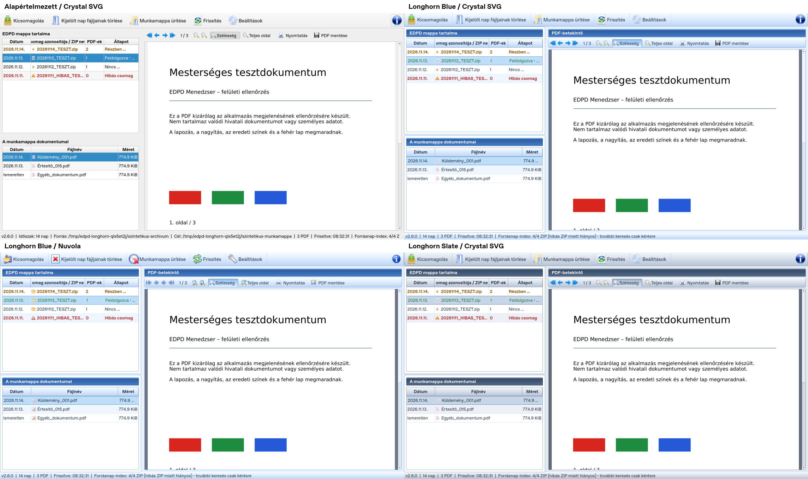

# Longhorn Blue és Longhorn Slate – EDPD Menedzser 2.6.2

Bekapcsolás: **Beállítások → Megjelenés → Felületi stílus → Longhorn Blue vagy Longhorn Slate → Mentés**. A Mégse nem ment és nem változtat megjelenést. Ugyanitt a rendelkezésre álló **Fusion, Windows, Vista** gyári Qt-stílusok választhatók; gyári stílusra váltás teljesen megszünteti a Longhorn stíluslapot és palettát. Csak a helyileg telepített Qt-stílusok jelennek meg. A Vista címke belső neve `windowsvista`.

A Megjelenés csoportnak **két választója** van: Felületi stílus és Ikontéma (12 készlet). Longhorn belső alapja Fusion; ehhez nincs külön felhasználói választó. Az EXE ikonja és a `%APPDATA%\EDPD\settings.json` helye változatlan. Az új `ui_style` mező a régi `surface_theme` aktív Longhorn-választását veszi át elsőként, egyébként a `qt_style` értékét. Ismeretlen/hiányzó gyári stílus Fusionra esik vissza. A régi mezőket szinkronban megőrizzük a korábbi verziókkal; a többi beállítás nem vész el. Az új telepítés Fusionnal indul.

## Megvalósítás

A `src/edpd/ui/themes/` közös témakezelőt, két kis palettát és egy közös QSS-sablont tartalmaz. Nincsenek nagy háttérképek, folyamatos dekoratív animációk vagy Windows DWM/blur hívások. A natív címsor és ablakkezelő gombok megmaradnak. A referencia a grafikai irányt adta; nem másoltunk belőle menüket, mintatáblázatokat vagy dokumentumokat a program működésébe.

A Blue világos ezüstkék alapot, fényes kék panelcímeket, finom kereteket és domború gombállapotokat használ. A Slate ugyanazokkal a komponensekkel, kékesszürke és sötétebb, visszafogottabb palettával működik. A fő eszköztár 40 pixeles ikonjai és +2 pontos feliratai, a PDF-eszköztár 22 pixeles ikonjai és meglévő csoportközei megmaradnak. A PDF-betekintő dekoratív címe csak Longhorn mellett jelenik meg.

QSS díszíti az eszköztárakat, panelcímeket, táblázatfejléceket, váltakozó sorokat, gombokat, beviteli mezőket, csoportokat, üzenetablakokat és állapotsort. Három kis kiegészítés szükséges: a kijelölt sor delegáltja megtartja a zöld/barna/piros szemantikus szövegszínt; a lenyílók saját kis Qt-rajzolt jelzést kapnak; keskeny állapotsornál a fontos rövid összegzés látszik. A teljes státuszszöveg továbbra is a `currentMessage()` értéke és a teljes tooltip, benne a forrás/cél útvonalakkal. A natív Windows fájlválasztást és Mentés másként ablakot továbbra is a meglévő QFileDialog hívások adják.

Visszaváltáskor az alkalmazás stíluslapja teljesen kiürül, a korábbi natív paletta visszatér, a Longhorn PDF-cím eltűnik. Qt-stílusváltáskor az új gyári stílus palettája lesz az alap. A váltás nem építi újra a főablakot, nem tölti újra a dokumentumokat, és nem kér hálózati ellenőrzést. Rögzített nagyításnál a PDF-pixmap nem renderelődik újra; a Szélesség/Teljes oldal nézet a rendelkezésre álló területhez továbbra is igazodik.

## Valódi alkalmazásképek

Az alábbi PNG-k a tényleges PySide2/Qt 5.15 alkalmazás Linux Fusion felületéről készültek. A képeket a `scripts/capture_longhorn.py` állítja elő, elkülönített ideiglenes mappákban létrehozott, mesterséges PDF-ek és ZIP-ek tényleges beolvasásával. A folyamatablak egy valós, mesterséges dokumentumokon végzett kicsomagolásból készült, a teszt a képkészítés idejére várakoztatja a haladási visszajelzést. Egyetlen éles hálózati mappát sem használ. Az összehasonlító kép kizárólag a négy tényleges képernyő elrendezése; nem generált látványterv és nem a csatolt referencia.

| Állapot | Kép |
| --- | --- |
| Alapértelmezett | [Képernyőkép](longhorn-default.png) |
| Longhorn Blue + Crystal SVG | [Képernyőkép](longhorn-blue-crystal.png) |
| Longhorn Blue + Nuvola | [Képernyőkép](longhorn-blue-nuvola.png) |
| Longhorn Slate + Crystal SVG | [Képernyőkép](longhorn-slate-crystal.png) |
| Blue Beállítások | [Képernyőkép](longhorn-blue-settings.png) |
| Blue kicsomagolás | [Képernyőkép](longhorn-blue-extraction.png) |



Újra előállítás:

```bash
QT_QPA_PLATFORM=offscreen python scripts/capture_longhorn.py --output docs
```

## Ellenőrzések és korlátok

A tesztek vizsgálják a mentést, a Mégse működését, a korábbi profilok kompatibilitását, a teljes paletta-visszaállítást, az összes gyári Qt-stílus és 12 ikontéma kombinációját, a kijelölt szemantikus színek tényleges festését, a színes PDF-pixelek és eredeti PDF-bájtok megőrzését, valamint az ismételt váltás utáni objektumszámot és Python-memóriát. A véges stresszpróba nem minden lehetséges környezetre kiterjedő memóriaszivárgás-bizonyíték.

A 1280×720, 1600×900 és 1920×1080 méreteket tényleges Qt-ablakméretekkel vizsgáljuk. A Linux mérés a `longhorn-visual-validation.json` fájlban van. Nagyon keskenyre húzott panelen az eredeti QToolBar túlcsorduló menüje továbbra is elérhető; a négy PDF-művelet szöveges felirata nem válik ikon nélküli vagy névtelen műveletté.

A Windows workflow a csomagolt EXE teljes, 20 pontos funkcionális önellenőrzését Alapértelmezett, Blue és Slate témával, majd Blue mellett 125% és 150% Qt-skálázással is futtatja. A `QT_SCALE_FACTOR` és `PassThrough` beállítás a folyamatra érvényes, nem módosítja a Windows asztal tényleges DPI-beállítását. A jelentés tartalmazza a tényleges device pixel ratio értékét. A Windows DPI-beállításának célgépes váltása és a valódi Windows 10 1607 x64 átvétel külön szükséges.

A csomagolt EXE QSS-ellenőrzőösszegeit összevetjük a forrással: a témák Python-modulokban vannak, külső képet vagy stíluslapot nem kell futás közben letölteni. A Windows-jelentések és a csomagolt programból készült további képek a kiadási ZIP-ben is megtalálhatók.
