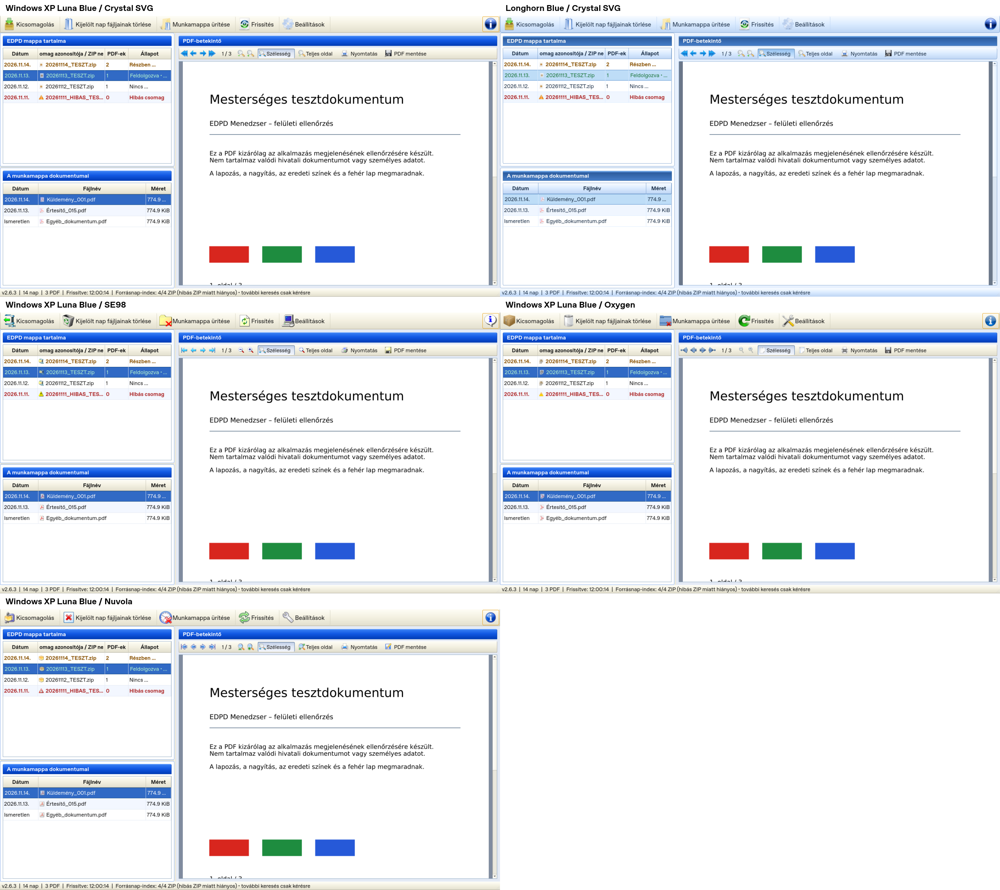

# Windows XP Luna Blue – EDPD Menedzser 2.6.3

Bekapcsolás: **Beállítások → Megjelenés → Felületi stílus → Windows XP Luna Blue → Mentés**. A stílus újraindítás nélkül alkalmazható; a Mégse nem változtatja meg a futó megjelenést. Újraindítás után a meglévő `%APPDATA%\EDPD\settings.json` `ui_style` mezőjéből töltődik vissza. A korábbi profilok, útvonalak, időzítők és elrendezések megmaradnak. A Fusion, Windows és Vista választékot továbbra is a helyileg elérhető Qt-stílusok adják; a Luna az operációs rendszer témájától független.

## Saját Luna-kialakítás

A Luna külön QSS-szabályokat és palettát kapott a meglévő témarendszeren belül. A klasszikus asztali alkalmazáshoz illő részletek: finom krém–ezüst eszköztárak, sima királykék panelcímek, fehér félkövér felirat, világos, domború táblázatfejlécek. A gombok kék szegélyűek, hover és fókusz alatt meleg narancsos kiemelést kapnak; lenyomva a felső él sötétebb, az alsó világosabb. A folyamatjelző szegmentált zöld. A párbeszédek krémszínűek, a lenyílómezők jobb oldala halványkék, a menük kijelölése kék/fehér.

Ez eltér a Longhorn üvegszerű kék eszköztáraitól, hangsúlyos fénysávos panelcímeitől és kerekebb kereteitől. A Longhorn Blue és Slate előállított QSS-ének SHA-256 értéke változatlan a 2.6.2-höz képest; ezt külön regressziós teszt ellenőrzi.

A Luna kizárólag saját Qt-színátmenetekből, keretekből és vezérlőrajzolásból készül. Nem került be Windows XP-ből másolt msstyles/DLL/BMP, új betűkészlet, külső témamotor vagy futásidejű függőség. A natív Windows-címsor és ablakkeret megmarad; a stílus az alkalmazás belső Qt-felületére vonatkozik.

## Közös kezelés és visszaállítás

A Qt-független `edpd.surface_styles` névjegyzék adja a felületi neveket és a képfájlok azonosítóit. Ezt használja a profilátvétel, a központi `SurfaceThemeManager`, az összevont stílusválasztó és az önellenőrzés. A natív és az alkalmazásstílusok feloldása külön névjegyzékből történik; nincs rögzített elemszámú listavágás. A QSS-gyorsítótár mindhárom egyedi felületet megőrzi.

A gyári stílusra visszaváltás kiüríti a QSS-t és helyreállítja a gyári palettát. A Longhorn-változatok a saját eredeti megjelenésüket kapják vissza. A váltás nem építi újra a főablakot, nem indít hálózati/ZIP-újraolvasást, nem változtatja meg a kiválasztott ikontémát vagy a rögzített nagyítású PDF-pixmapot. A három panel, oszlopsorrend, oszloparányok, sormagasságok, 40/22 pixeles ikonméretek és a fő eszköztár +2 pontos feliratai megmaradnak.

A Luna kijelölése klasszikus erős kék (`#316ac5`). A kijelölt zöld/barna/piros állapotszövegekhez a delegált világos zöld/borostyán/piros árnyalatot használ, legalább 4,5:1 kontraszttal. A modellben tárolt eredeti színek és a nem kijelölt sorok nem változnak. A fehér PDF-oldalra semmilyen effektus nem kerül.

Mind a **12 ikontéma**, köztük az SE98, a Crystal SVG, az Oxygen és a Nuvola használható. A 2.6.2 összes ikonfájlja, szerepkiosztása, licencanyaga és az állandó EXE-embléma változatlan.

## Tényleges alkalmazásképek

Az alábbiak a futó PySide2/Qt 5.15 alkalmazás képei, szintetikus PDF-ekkel és helyi ZIP-ekkel. Nem látványtervek. A főablakképek az ablak kliensrészét mutatják; a natív Windows-címsor nem része a Qt-widget képkivágásának. A kicsomagolási kép valódi, mesterséges dokumentumokon végzett művelet folyamatablakát mutatja, a haladás visszajelzésének rövid tesztoldali várakoztatásával.

| Változat | Kép |
| --- | --- |
| Luna + Crystal SVG | [Képernyőkép](xp-luna-crystal.png) |
| Luna + SE98 | [Képernyőkép](xp-luna-se98.png) |
| Luna + Oxygen | [Képernyőkép](xp-luna-oxygen.png) |
| Luna + Nuvola | [Képernyőkép](xp-luna-nuvola.png) |
| Longhorn Blue + Crystal, azonos adatokkal | [Összevetési alap](xp-luna-longhorn-blue.png) |
| Luna – Beállítások | [Párbeszédablak](xp-luna-settings.png) |
| Luna – kicsomagolás | [Valódi folyamatablak](xp-luna-extraction.png) |



Újra előállítás, kizárólag ideiglenes tesztmappákkal:

```bash
QT_QPA_PLATFORM=offscreen python scripts/capture_longhorn.py --mode xp-luna --output docs
```

A mappa Linux Fusion/Qt képei mellé a Windows Release `modern-runner-selftest-screenshots/` és `surface-reports/` könyvtárai a tényleges csomagolt EXE képeit is tartalmazzák. A Luna saját EXE-próbája 100/125/150%-os Qt-skálázással is fut; a jelentések a tényleges device pixel ratio értékét rögzítik.

## Ellenőrzések

A regressziós tesztek vizsgálják a mentést/visszatöltést, a régi profilok átvételét, az azonnali hálózatmentes váltást, az összes gyári stílus és mind a 12 ikontéma kombinációját, a színes PDF-bájtokat/pixeleket, a ténylegesen festett szemantikus színeket, a hover/lenyomott/letiltott gombállapotokat, valamint az ismételt váltások utáni palettát, objektumszámot és Python-memóriát.

A témavalidáció mind a négy felületet 1280×720, 1600×900 és 1920×1080 valódi Qt-ablakmérettel vizsgálja. A Luna Beállítások/Névjegy/folyamatablak elrendezését mindhárom méretnél ellenőrzi: a látható fontos vezérlők a párbeszédablakon belül maradnak. A PDF-eszköztár nagyon keskeny panelen a meglévő QToolBar túlcsorduló menüjét használhatja. Nincs új navigáció vagy fájlválasztó-implementáció.

Az EXE teljes 20 pontos funkcionális önellenőrzése az alapváltozaton túl Blue/Slate/Luna stílussal és Blue/Luna mellett 125/150%-os Qt-skálázással is fut. A Windows asztal DPI-beállítását ez nem változtatja meg. A Windows 10 1607 x64, a munkahelyi SMB-megosztás és a valódi nyomtató külön célgépes átvételi próba marad; a modern runner eredménye ezt nem helyettesíti. A véges stresszpróba nem minden környezetre kiterjedő memóriaszivárgás-bizonyíték.
